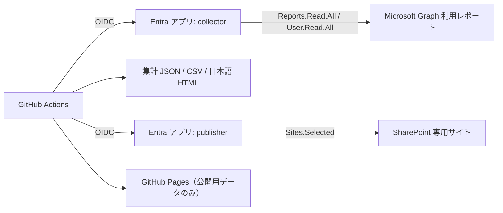

# セットアップガイド（自分のテナントで動かす）

このガイドは、自分の Microsoft 365 テナントで同じ仕組みを作る人向けです。**先に「1. 事前に必要な権限」を確認してください。** 権限がないと途中で止まります。

> 注意: 実測は「架空の人物だけのデモテナント」で行っています。実在の従業員がいる環境で使う場合は、「3. 実環境での注意」を必ず読んでください。

## 前提条件チェックリスト（最初にここだけ確認）

着手前に、次の表がすべて「はい」になるかを確認してください。1 つでも「いいえ」なら、先にその権限・契約を用意します。詳細な権限は「1. 事前に必要な権限」にあります。

| # | 確認項目 | 必要な状態 | 確認方法 |
|---|---------|-----------|---------|
| 1 | Microsoft 365 テナント | Copilot ライセンスが割り当てられたユーザーがいる | 管理センター → 課金 → ライセンス |
| 2 | Entra の管理者操作 | アプリ登録、アプリケーション権限への管理者同意（Privileged Role Administrator か Global Administrator）ができる人が操作できる | Entra 管理センター → ロールと管理者 |
| 3 | SharePoint | 専用サイトを作れる（SharePoint 管理者）。SPFx を使うならアプリカタログも必要 | SharePoint 管理センター |
| 4 | レポートの匿名化設定 | 部門別にするなら「名前を匿名化して表示」をオフにできる（実在従業員がいる環境は組織承認が先） | 管理センター → 設定 → 組織設定 → レポート |
| 5 | GitHub アカウント | **GitHub Free の個人アカウントで足ります**。Enterprise / Enterprise Managed Users は不要。Actions と OIDC が使えること | リポジトリの Settings → Actions |
| 6 | GitHub Pages | 公開リポジトリなら Free で可。**非公開リポジトリで Pages を使うには有料プランが必要**。Pages には加工済みの公開用データだけを載せる | Settings → Pages |
| 7 | Agentic 解説（任意） | Copilot が使える個人アカウント。Copilot 契約がなければ解説なしでも他は動く | 個人設定 → Copilot |
| 8 | ローカル作業環境（任意） | `gh`（GitHub CLI）、`az`（Azure CLI）、PowerShell 7、Node.js が入っている | `gh --version` など |

> 組織（GitHub Organization / Enterprise）で運用する場合は、Actions の許可アクション、OIDC の subject 形式、Pages の公開範囲が組織ポリシーで制限されることがあります。管理者に事前確認してください。

## 0. 全体の流れ

シークレット（クライアントシークレット）は作りません。GitHub Actions の OIDC（フェデレーション資格情報）で Entra に認証します。

## 1. 事前に必要な権限

### 1-1. Microsoft 365 / Entra 側

| # | 何をするか | 必要な権限・条件 | 補足 |
|---|-----------|------------------|------|
| 1 | Entra アプリ登録 2 個（collector と publisher）の作成 | アプリを登録できるロール（Application Developer 以上） | 1 つのアプリにまとめず、役割ごとに分けます |
| 2 | collector に Graph の**アプリケーション権限**を付与 | **Reports.Read.All** と **User.Read.All** のみ。付与には**管理者の同意**（Privileged Role Administrator、または Global Administrator）が必要 | これ以外は付けません |
| 3 | publisher に Graph のアプリケーション権限を付与 | **Sites.Selected** のみ（管理者の同意が必要） | 同意だけでは SharePoint に書けません（403）。次の項目が必要です |
| 4 | publisher に**専用サイト 1 件**への書き込みを付与 | サイト単位の権限付与（`POST /sites/{id}/permissions`）。呼び出しには一時的に強い権限（Sites.FullControl.All 等）が必要 | 付与後は一時権限・フェデレーション資格情報を必ず回収します。常駐の全サイト権限は付けません |
| 5 | GitHub Actions を信頼する設定 | 各アプリに**フェデレーション資格情報**（issuer は `https://token.actions.githubusercontent.com`）を追加できること | subject は `oidc-probe.yml` で**実際の値**を取得してから設定します。推測しません |
| 6 | 専用の SharePoint サイトを作る | SharePoint 管理者、またはサイトを作成できる権限 | 既存の共有サイトに書かず、専用サイトを推奨します |
| 7 | Copilot 利用レポートの取得 | 対象ユーザーに Microsoft 365 Copilot ライセンスが割り当てられていること | ライセンスがないユーザーは行に出ません |
| 8 | レポートの**ユーザー名の匿名化設定** | 管理センターの設定を変更できる管理者（Reports の設定） | 「ユーザー、グループ、サイトの名前を匿名化して表示」が**オンだと UPN が 32 桁の ID になり**、部門との突合ができません（ガイド 3 を参照） |

最小権限の人間用ロールは検証していません。デモでは、検証用に Global Administrator で操作しました。

### 1-2. SPFx（SharePoint の Web パーツ）を使う場合の追加権限

| # | 何をするか | 必要な権限・条件 |
|---|-----------|------------------|
| 1 | テナントのアプリカタログを作る | SharePoint 管理者（テナントでアプリカタログが未作成の場合） |
| 2 | パッケージ（`.sppkg`）をアップロード・デプロイ | アプリカタログのサイトコレクション管理者 |
| 3 | 専用サイトへインストール | 対象サイトのサイト管理者 |
| 4 | 利用者が閲覧する | 利用者が専用サイトの閲覧権限を持つこと（部門はフィルターで、アクセス制御ではありません） |

全サイトへの自動配備や、SharePoint の匿名公開はしません。

### 1-3. GitHub 側

| # | 何をするか | 必要な権限・条件 |
|---|-----------|------------------|
| 1 | リポジトリの作成 | 自分のアカウント。**非公開リポジトリ**での運用を推奨 |
| 2 | Actions の OIDC | ワークフローの `permissions` に `id-token: write` と `contents: read` |
| 3 | リポジトリ変数の登録 | リポジトリの管理権限（Settings → Variables） |
| 4 | GitHub Pages | Pages を有効にし、公開は**加工済みの公開用データだけ**にします |
| 5 | Agentic 解説（任意） | Copilot が使える個人アカウントで、**fine-grained PAT**（Account permissions: **Copilot Requests = Read-only**、対象リポジトリを 1 つに限定、期限は短め）を作り、リポジトリシークレット `COPILOT_GITHUB_TOKEN` に登録します。手順の詳細は GitHub Agentic Workflows の[認証ドキュメント](https://github.github.com/gh-aw/reference/auth/)を参照 |

PAT の値はチャットやログに貼らず、クリップボードから直接 `gh secret set` で登録します。

### 1-4. Viva Insights を使う場合

- Viva Insights の Analyst ロールが必要です。
- Viva の自動取得は**このサンプルでは未達**です（Partition ID・Query ID・公式コネクタでの取得を確認できていません）。

## 2. 手順

### 手順 1: リポジトリを作る

このリポジトリを参考に、自分のリポジトリへコードをコピーします（履歴やデモ用データは引き継がないでください）。

### 手順 2: Entra アプリを 2 つ作る

1. `collector` を作り、アプリケーション権限 **Reports.Read.All** / **User.Read.All** を追加して管理者の同意を付与します。
2. `publisher` を作り、アプリケーション権限 **Sites.Selected** だけを追加して管理者の同意を付与します。
3. クライアントシークレットは作りません。

### 手順 3: OIDC の subject を確認してフェデレーションを設定する

1. `oidc-probe.yml` を手動実行し、ログに出る実際の `sub` を確認します（`sub` / `aud` / `iss` / `repository` / `repository_id` / `repository_owner_id` / `ref` だけが出力されます）。
2. その値と**完全一致**する subject で、各アプリにフェデレーション資格情報を作ります。

### 手順 4: 専用 SharePoint サイトを作り、publisher に書き込みを付与する

1. 専用サイトを作ります（所有者を示すマーカーをサイトの説明に入れます）。
2. サイト単位の権限付与で publisher にこのサイトだけの write を付与します。
3. **付与に使った一時権限・フェデレーション資格情報は回収し**、0 件になったことを読み戻して確認します。
4. 確認の目安として、publisher が**未付与のサイトのルート**を読むと 403 になることを見ます。

### 手順 5: リポジトリ変数を登録する

次の変数を、独立に確認した値で登録します。推測した既定値は使いません。

| 変数 | 内容 |
|------|------|
| `TENANT_ID` | テナント ID |
| `COLLECTOR_CLIENT_ID` | collector のアプリケーション（クライアント）ID |
| `PUBLISHER_CLIENT_ID` | publisher のアプリケーション（クライアント）ID |
| `SPO_SITE_ID` | 専用サイトの ID |
| `SPO_LIBRARY_ID` | ドキュメントライブラリの ID |
| `SPO_SITE_PATH` | `/sites/<サイト名>` の形式 |
| `SPO_OWNERSHIP_MARKER` | サイトの説明に入れた所有者マーカー |

### 手順 6: ワークフローを手動で実行する

1. `live-validation.yml` で、Graph からの取得と、部門別の SharePoint 保存を確認します。
2. `calendar-validation.yml` で、日別の取得、履歴の復元、暦月の生成、保存、読み戻し照合までを確認します。
3. 失敗した場合、取得できなかった値を 0 や古い成功値で置き換えず、停止します。

### 手順 7: 公開 Pages（任意）

`synthetic-pages.yml` が、公開用データだけで静的サイトを作って配備します。実データを載せるのは、公開してよいと本人が承認した加工済みデータに限ります。

## 3. 実環境での注意

- **匿名化の設定**: 部門別の配信には、レポートのユーザー名の匿名化をオフにする必要があります。実在の従業員がいる環境では、個人が特定される形になるため、組織の承認とプライバシー確認を先に行ってください。デモでは全員が架空の人物でした。
- **公開 Pages に実データを出さない**: 個人の行・UPN・氏名を公開しないでください。
- **ライセンスの自動回収は対象外**です。「月 20 回未満」のような基準は、対象期間・指標（actions か prompts か）・Copilot Chat を含めるかを決めてから採用してください。
- **取得の遅延**: 日別データは通常、UTC の日末から 48 時間以内に取得できるようになります。
- **当月は不完全**です。確定値は月が終わってから取得します。

## 4. 公式ドキュメント

- [Workload identity federation（Entra）](https://learn.microsoft.com/ja-jp/entra/workload-id/workload-identity-federation)
- [Copilot の利用レポート API（Microsoft Graph）](https://learn.microsoft.com/ja-jp/microsoft-365/copilot/extensibility/api/admin-settings/reports/copilotreportroot-getmicrosoft365copilotusageuserdetail)
- [Sites.Selected によるサイト単位のアクセス](https://learn.microsoft.com/ja-jp/graph/permissions-selected-overview)
- [SharePoint のアプリカタログ](https://learn.microsoft.com/ja-jp/sharepoint/use-app-catalog)
- [GitHub Agentic Workflows の認証](https://github.github.com/gh-aw/reference/auth/)
